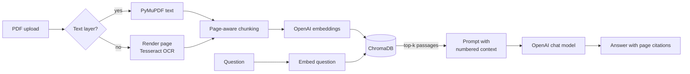

# scanned-docs-rag


**Ask questions about scanned PDFs and get answers that cite the exact document and page.**

Many real documents (contracts, invoices, letters, archive material) are scans with no usable
text layer, so a plain "chat with your PDF" tool sees nothing. This project detects those pages,
runs OCR on them, and builds a retrieval-augmented generation (RAG) pipeline on top, so every
answer points back to the page it came from.

## Features

- **Hybrid text extraction:** uses the PDF text layer when it exists, falls back to Tesseract OCR
  per page when it doesn't (English + German by default)
- **Page-aware chunking:** chunks never cross page boundaries, so citations are exact; OCR
  hyphenation across line breaks is repaired
- **Grounded answers with citations:** answers cite passages as `[1]`, `[2]`, each mapped to a
  document and page number
- **Streaming:** answers stream token by token over server-sent events
- **Idempotent ingestion:** re-ingesting a file replaces its old chunks instead of duplicating them
- **REST API + CLI:** FastAPI service with OpenAPI docs, plus a `docrag` command-line tool
- **Tested without API keys:** the test suite uses fake embedding and chat models, so CI runs
  free and deterministic

## Architecture



| Component | Choice |
| --- | --- |
| PDF parsing | PyMuPDF |
| OCR | Tesseract (`pytesseract`) |
| Embeddings | OpenAI `text-embedding-3-small` |
| Vector store | ChromaDB (persistent, cosine similarity) |
| LLM | OpenAI `gpt-4o-mini` (configurable) |
| API | FastAPI + server-sent events |

## Quickstart

**Requirements:** Python 3.10+, Tesseract, and an OpenAI API key.

```bash
# 1. Install Tesseract (with German language data)
brew install tesseract tesseract-lang        # macOS
# sudo apt-get install tesseract-ocr tesseract-ocr-deu   # Ubuntu

# 2. Install the project
git clone https://github.com/<your-username>/scanned-docs-rag.git
cd scanned-docs-rag
python -m venv .venv && source .venv/bin/activate
pip install -e ".[dev]"

# 3. Add your API key
cp .env.example .env    # then edit .env
```

### Command line

```bash
docrag ingest path/to/file.pdf path/to/folder/
docrag ask "What is the total amount on the invoice?"
```

Example output:

```text
The invoice total is 1,250 EUR [1].

Sources:
  [1] invoice_scan.pdf, page 1 (similarity 0.71)
```

### REST API

```bash
docrag serve        # then open http://127.0.0.1:8000/docs
```

| Method | Endpoint | Description |
| --- | --- | --- |
| `GET` | `/health` | Health check |
| `POST` | `/documents` | Upload and ingest a PDF (`?force_ocr=true` to OCR every page) |
| `GET` | `/documents` | List ingested documents |
| `DELETE` | `/documents/{name}` | Remove a document |
| `POST` | `/ask` | Answer a question: `{"question": "...", "top_k": 5}` |
| `POST` | `/ask/stream` | Same, streamed as SSE events: `sources`, `token`..., `done` |

```bash
curl -F "file=@invoice.pdf" http://127.0.0.1:8000/documents
curl -X POST http://127.0.0.1:8000/ask -H "Content-Type: application/json" \
     -d '{"question": "Who is the customer?"}'
```

## Configuration

All settings can be set in `.env` (see `.env.example`):

| Variable | Default | Meaning |
| --- | --- | --- |
| `OPENAI_API_KEY` | - | Your OpenAI key |
| `DOCRAG_CHAT_MODEL` | `gpt-4o-mini` | Model that writes the answers |
| `DOCRAG_EMBEDDING_MODEL` | `text-embedding-3-small` | Embedding model |
| `DOCRAG_OCR_LANGUAGES` | `eng+deu` | Tesseract languages |
| `DOCRAG_CHUNK_SIZE` / `DOCRAG_CHUNK_OVERLAP` | `1000` / `150` | Chunking (characters) |
| `DOCRAG_TOP_K` | `5` | Passages retrieved per question |

## Development

```bash
pytest              # 23 tests, no API key needed
ruff check . && ruff format --check .
```

## Project structure

```text
src/scanned_docs_rag/
├── ingest.py       # PDF -> pages, OCR fallback
├── chunking.py     # page-aware recursive chunking
├── embeddings.py   # embedding model interface + OpenAI
├── store.py        # ChromaDB vector store
├── llm.py          # chat model interface + OpenAI (streaming)
├── pipeline.py     # ingestion + retrieval + cited answers
├── api.py          # FastAPI service
├── cli.py          # docrag command
└── config.py       # settings from environment / .env
```

## Roadmap

- [ ] Evaluation: question/answer test set, retrieval hit rate and answer faithfulness (RAGAS)
- [ ] Layout-aware parsing for tables and multi-column pages
- [ ] Hybrid search (BM25 + embeddings) and re-ranking
- [ ] Docker image and deployment (Google Cloud Run)
- [ ] React web interface with highlighted source passages

## License

MIT
